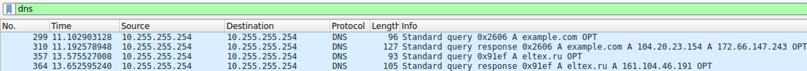
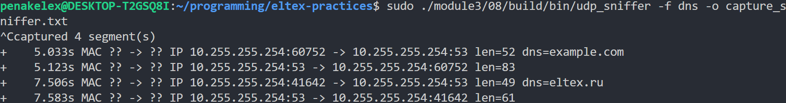
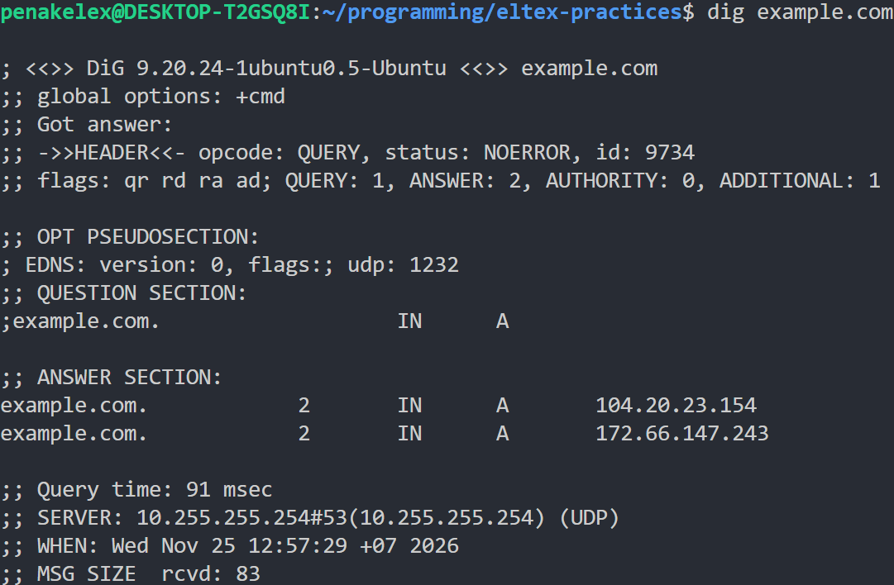
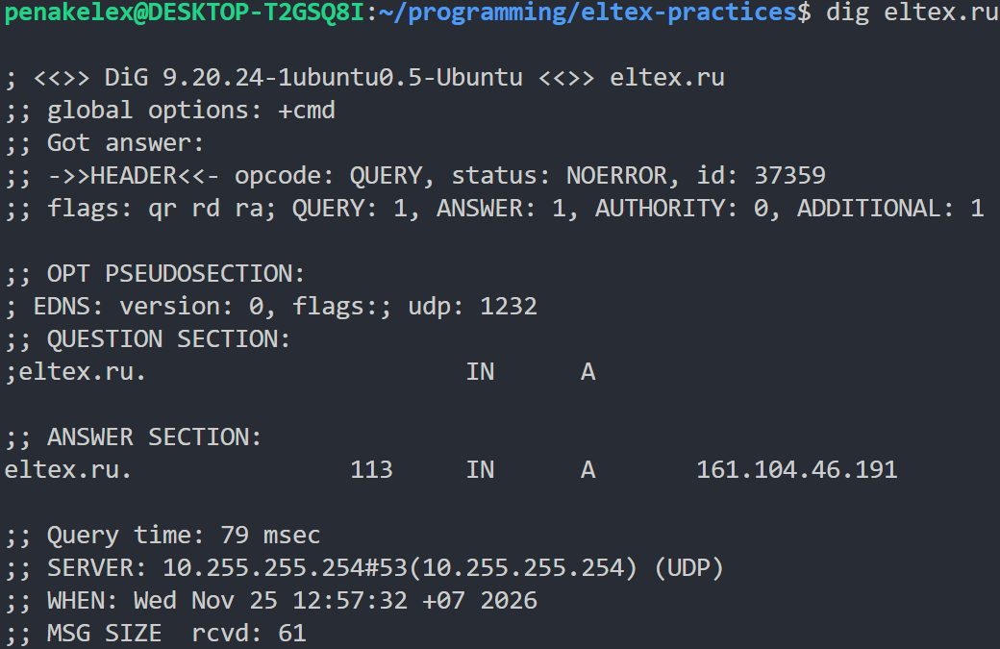

# Отчёт: проверка корректности перехвата UDP-сегментов

## Методика проверки

Проверка выполнялась на DNS-трафике (фильтр программы `dns`):

1. В терминале 1 запущен сниффер:
   `sudo ./module3/08/build/bin/udp_sniffer -f dns -o capture_sniffer.txt`
2. Одновременно в Wireshark запущен захват на интерфейсе `any` без
   фильтра захвата; для отображения DNS-пакетов использован
   отображаемый фильтр `dns`.
3. В терминале 2 трафик генерировался командами
   `dig example.com` и `dig eltex.ru`.
4. Оба захвата остановлены, результаты сравнены.

Интерфейс `any` выбран потому, что в WSL2 DNS-запросы системного
резолвера идут через loopback (сервер `10.255.255.254` — NAT-резолвер
Windows-хоста), и на `eth0` этот трафик не виден. Дамп захвата
Wireshark сохранён в файле `dns.pcapng` рядом с этим отчётом.

## Скриншоты

Список DNS-пакетов в Wireshark (отображаемый фильтр `dns`):

Вывод программы после остановки захвата:

Вывод `dig example.com`:

Вывод `dig eltex.ru`:

## Сравнение результатов

Wireshark и сниффер зафиксировали одни и те же 4 сегмента — два запроса
и два ответа. Время в Wireshark отсчитывается от начала захвата
Wireshark, у сниффера — от начала своего захвата, поэтому сравниваются
интервалы между запросом и ответом и остальные поля.

| Сегмент            | Wireshark (время, с) | Сниффер (время, с) | IP отправителя → получателя     | Порты      | Длина (сниффер) | Длина кадра (Wireshark) |
| ------------------ | -------------------- | ------------------ | ------------------------------- | ---------- | --------------- | ----------------------- |
| запрос example.com | 11.103               | +5.033             | 10.255.255.254 → 10.255.255.254 | 60752 → 53 | 52              | 96                      |
| ответ example.com  | 11.193               | +5.123             | 10.255.255.254 → 10.255.255.254 | 53 → 60752 | 83              | 127                     |
| запрос eltex.ru    | 13.576               | +7.506             | 10.255.255.254 → 10.255.255.254 | 41642 → 53 | 49              | 93                      |
| ответ eltex.ru     | 13.653               | +7.583             | 10.255.255.254 → 10.255.255.254 | 53 → 41642 | 61              | 105                     |

Пояснения к совпадениям:

- **Интервалы запрос–ответ.** example.com: Wireshark
  11.193 − 11.103 = 0.090 с, сниффер 5.123 − 5.033 = 0.090 с, `dig`
  сообщает «Query time: 91 msec». eltex.ru: 13.653 − 13.576 = 0.077 с,
  7.583 − 7.506 = 0.077 с, `dig` — «79 msec». Интервалы совпадают.
- **Длины.** Колонка `len=` сниффера — длина UDP-полезной нагрузки,
  колонка Length в Wireshark — длина всего кадра. Разница во всех
  строках ровно 44 байта: 16 (заголовок Linux Cooked Capture на
  интерфейсе `any`) + 20 (IPv4) + 8 (UDP): 52 + 44 = 96, 83 + 44 = 127,
  49 + 44 = 93, 61 + 44 = 105. Длины ответов (83 и 61) совпадают также
  с «MSG SIZE rcvd» в выводе `dig`.
- **Адреса и порты.** IP-адреса совпадают (оба — `10.255.255.254`,
  резолвер WSL3). Номера портов соответствуют парам запрос/ответ.
- **Имена доменов.** Сниффер извлёк из DNS-запросов имена
  `example.com` и `eltex.ru` — те же, что показывает Wireshark в колонке
  Info и `dig` в Question Section.

MAC-адреса в обоих инструментах «пустые» (сниффер выводит `??`,
Wireshark — `00:00:00:00:00:00`): трафик проходил через loopback,
где нет канального уровня Ethernet, поэтому настоящих MAC-адресов
у этих сегментов нет по определению. Для трафика через `eth0`
(например, `dig @8.8.8.8 example.com`) программа выводит реальные
MAC-адреса: собственный интерфейса — через `getifaddrs`, адрес
шлюза — из ARP-кэша.
